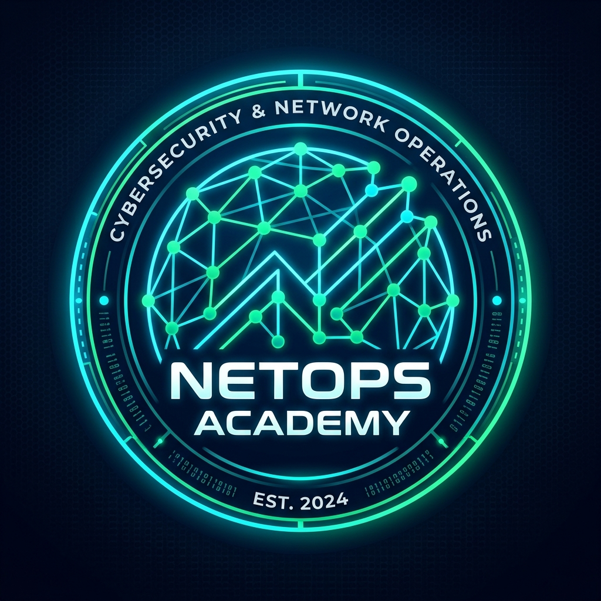
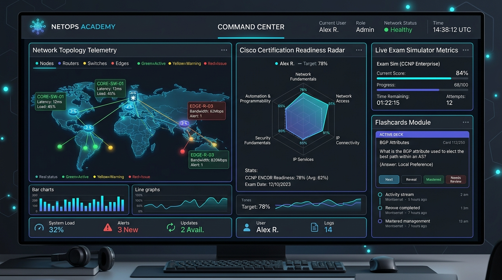

<p align="center">
  
</p>

<h1 align="center">🌐 NetOps Academy — Enterprise NOC Engine</h1>

<p align="center">
  <strong>Plateforme d'ingénierie réseau, simulation d'examens officiels et laboratoire virtuel haute fidélité.</strong>
</p>

<p align="center">
  
  
  
  
  
  
</p>

---

## 📸 Capture d'Écran — Console de Pilotage NOC

<p align="center">
  
</p>

---

## 📌 Sommaire

- [🌟 Présentation](#-présentation)
- [✨ Fonctionnalités Clés](#-fonctionnalités-clés)
- [🏆 Cursus & Certifications Couverts](#-cursus--certifications-couverts)
- [🧠 Moteur de Flashcards & Répétition Espacée (SRS)](#-moteur-de-flashcards--répétition-espacée-srs)
- [☁️ Encyclopédie & Matrice Multi-Cloud](#-encyclopédie--matrice-multi-cloud)
- [🔬 Simulateur d'Examen & Ateliers Labs](#-simulateur-dexamen--ateliers-labs)
- [🔒 Authentification & Base de Données Firestore](#-authentification--base-de-données-firestore)
- [⌨️ Raccourcis Clavier Pro](#️-raccourcis-clavier-pro)
- [🛠️ Stack Technique](#️-stack-technique)
- [🚀 Démarrage Rapide](#-démarrage-rapide)

---

## 🌟 Présentation

**NetOps Academy** est une plateforme complète d'entraînement intensif pour ingénieurs et architectes réseau, cloud et cybersécurité. Conçue avec l'esthétique d'un **Network Operations Center (NOC)** moderne, elle intègre des simulateurs d'examens réalistes, un moteur de mémorisation basé sur le système de Leitner (SRS), un terminal interactif Cisco IOS-XE et une encyclopédie multi-cloud comparative.

L'application est entièrement synchronisée avec **Google Cloud Firestore** et sécurisée par **Firebase Auth** (Google Sign-In) avec des règles ABAC Zero-Trust.

---

## ✨ Fonctionnalités Clés

| Module | Icône | Description Technique |
| :--- | :---: | :--- |
| **Console NOC & Télémétrie** | 📊 | Métriques de session en temps réel, radar de faiblesses, cadence d'entraînement (streak) et compte à rebours d'examen. |
| **Moteur Flashcards SRS** | 🧠 | **1900+ flashcards haute fidélité** avec modes Focus 3D, Blitz 120s, audio TTS, filtres constructeurs et création personnalisée Firestore. |
| **Encyclopédie Multi-Cloud** | ☁️ | Matrice comparative exhaustive des services **AWS**, **Azure**, **GCP** et **CNCF** avec commandes CLI (`aws`, `az`, `gcloud`, `kubectl`, `terraform`). |
| **Simulateur d'Examen Officiel** | 📝 | Examen chronométré de **102 questions**, surveillance proctor, calculatrice de sous-réseaux IP/CIDR et archivage des scores en base. |
| **Laboratoires & Ateliers** | 🔬 | Topologies interactives (RoAS, BGP Multi-homing, OSPFv3, SD-WAN, VXLAN EVPN) avec validation automatique ICMP et ARP. |
| **Terminal Sandbox Cisco** | 💻 | Émulateur CLI IOS-XE interactif avec support des commandes de diagnostic (`show ip bgp summary`, `show ip route`, etc.). |
| **Banque de Questions & Filtres** | 🗄️ | Répertoire de questions classées par domaine blueprint Cisco avec explications techniques et références RFC. |
| **Persistance Firestore** | 🔒 | Synchronisation multi-appareils du profil, des scores, des flashcards personnalisées et des notes d'ingénierie. |

---

## 🏆 Cursus & Certifications Couverts

<p align="center">
  
  
  
  
  
  
  
</p>

- 🌐 **Cisco CCNA (200-301)** : Fondamentaux IP, Commutation LAN, Routage OSPF, Services IP, Sécurité et Automatisation.
- ⚙️ **Cisco CCNP Enterprise Core (350-401 ENCOR)** : Architecture double pile IPv4/IPv6, Virtualisation LISP/VXLAN, Infrastructure & Assurance.
- 🔀 **Cisco CCNP Advanced Routing (300-410 ENARSI)** : BGP multi-homing avancé, manipulation métrique EIGRP/OSPF, MPLS L3VPN, DMVPN Phase 3.
- 🛡️ **Cisco CCNP Security Core (350-701 SCOR)** : Architecture Zero Trust, PKI, IPsec IKEv2, Cisco ISE, VPN AnyConnect, Sécurité Cloud et NetFlow.
- 🔒 **Palo Alto Networks PCNSE** : Pare-feu nouvelle génération, profils de sécurité Threat Prevention, WildFire et NAT policy.

---

## 🧠 Moteur de Flashcards & Répétition Espacée (SRS)

Le système de flashcards est conçu pour l'ancrage mémoriel à long terme :

- **Animation 3D Flip** fluide sans décrochage visuel.
- **Synthèse Vocale (Web Speech API)** pour réviser en écoute audio les questions et spécifications RFC.
- **Mode Blitz (120 secondes)** : Défi contre la montre avec calcul du score de vélocité.
- **Boîtes de Leitner Spaced-Repetition** : Tri dynamique entre *À revoir*, *Maîtrisées* et *Favorites*.
- **Création de Cartes Personnalisées** : Enregistrées en direct dans votre collection Firestore `/users/{userId}/flashcards`.

---

## ☁️ Encyclopédie & Matrice Multi-Cloud

Un hub complet pour architectes réseau hybrides et cloud :

- **Glossaire Réseau Cloud** : Définitions complètes avec RFC, métadonnées et cas d'usage réels.
- **Matrice d'Équivalence Multi-Cloud** :
  - AWS Direct Connect ↔ Azure ExpressRoute ↔ GCP Cloud Interconnect
  - AWS Transit Gateway ↔ Azure Virtual WAN ↔ GCP Network Connectivity Center
  - AWS VPC Peering ↔ Azure VNet Peering ↔ GCP VPC Network Peering
- **Snippets CLI & IaC** : Commandes prêtes à l'emploi (`aws`, `az`, `gcloud`, `kubectl`, `terraform`).

---

## 🔬 Simulateur d'Examen & Ateliers Labs

- **Calculateur de Sous-Réseaux CIDR / VLSM** accessible en permanence (`Ctrl+K` ou clic rapide) :
  - Calcul instantané des adresses réseau, broadcast, premier/dernier hôte utilisable et masques binaires inversés (Wildcard).
- **Proctoring Virtuel** :
  - Décompte strict du temps imparti (2 heures).
  - Palette latérale des 102 questions avec indicateurs d'état (Répondu, En cours, Pour révision).
  - Bloc-notes scratchpad intégré pour poser vos calculs binaires.
  - Célébration confetti en cas de réussite (`Score >= 825/1000`).

---

## 🔒 Authentification & Base de Données Firestore

NetOps Academy intègre **Firebase Auth & Cloud Firestore** :

- **Google Sign-In natif** via popup sécurisé Firebase.
- **Synchronisation du Profil Ingénieur** :
  - Streak d'entraînement quotidien.
  - Précision globale et examen cible.
  - Historique complet des simulations passées.
- **Règles de Sécurité Zero-Trust (`firestore.rules`)** :
  - Isolement strict par UID (`request.auth.uid == userId`).
  - Validation exhaustive des schémas JSON et types de champs.
  - Immutabilité des dates de création (`createdAt == request.time`).
  - Protection contre les injections Denial-of-Wallet (bornes strictes de taille et regex d'ID).

---

## ⌨️ Raccourcis Clavier Pro

| Raccourci | Action |
| :--- | :--- |
| <kbd>Ctrl</kbd> + <kbd>K</kbd> / <kbd>Cmd</kbd> + <kbd>K</kbd> | Ouvrir la Palette de Commandes Universelle |
| <kbd>Espace</kbd> | Retourner la Flashcard (Face Recto / Verso) |
| <kbd>→</kbd> / <kbd>←</kbd> | Question ou Flashcard suivante / précédente |
| <kbd>1</kbd> / <kbd>2</kbd> / <kbd>3</kbd> / <kbd>4</kbd> | Sélectionner les options A, B, C, D du simulateur |
| <kbd>A</kbd> | Activer / Arrêter la lecture audio TTS |
| <kbd>F</kbd> | Marquer une question pour révision ultérieure |

---

## 🛠️ Stack Technique

- **Frontend** : [React 19](https://react.dev/), [TypeScript 5.8](https://www.typescriptlang.org/), [Vite 6](https://vitejs.dev/)
- **Styles** : [Tailwind CSS v4](https://tailwindcss.com/), Google Fonts (Geist, JetBrains Mono, Material Symbols)
- **Animations** : [Motion](https://motion.dev/), [Canvas-Confetti](https://www.npmjs.com/package/canvas-confetti)
- **Base de Données & Auth** : [Google Cloud Firestore](https://firebase.google.com/docs/firestore), [Firebase Authentication](https://firebase.google.com/docs/auth)
- **Icônes** : Material Symbols Outlined, Lucide React

---

## 🚀 Démarrage Rapide

### Prérequis

- **Node.js** >= 18.x
- **npm** ou **bun**

### Installation

```bash
# 1. Cloner le dépôt ou ouvrir le projet
git clone https://github.com/votre-compte/netops-academy.git
cd netops-academy

# 2. Installer les dépendances
npm install

# 3. Lancer le serveur de développement
npm run dev
```

L'application est disponible immédiatement sur `http://localhost:3000`.

### Scripts Disponibles

- `npm run dev` : Lance le serveur de développement Vite sur le port 3000.
- `npm run build` : Compile l'application TypeScript pour la production dans `/dist`.
- `npm run lint` : Vérifie la validité des types TypeScript (`tsc --noEmit`).

---

<p align="center">
  Développé pour les ingénieurs réseau, architectes cloud et passionnés de protocoles d'infrastructure.
</p>
